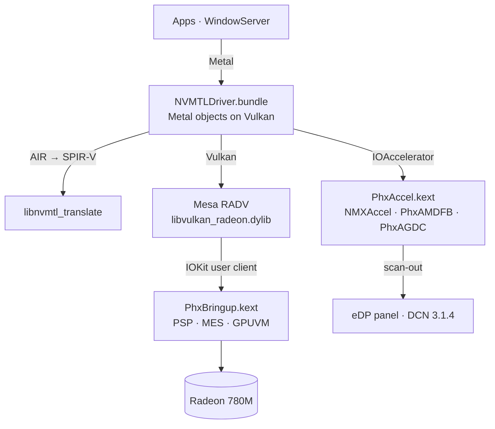

<p align="center">
  <picture>
    <source media="(prefers-color-scheme: dark)" srcset="assets/brand/nullarc-logo-dark.svg">
    
  </picture>
</p>

<p align="center">
  <b>Metal on AMD Radeon 780M for macOS Tahoe.</b><br>
  GPU bring-up, a display driver WindowServer composites on, and Metal over Vulkan (Mesa RADV)<br>
  for Phoenix / Hawk Point APUs (RDNA 3, GC 11.0.1, gfx1103).
</p>

<p align="center">
  
  
  
  <a href="https://github.com/luuumi-dev/nullarc/actions/workflows/ci.yml"></a>
  <a href="LICENSE"></a>
</p>

<p align="center"><b>English</b> · <a href="README_RU.md">Русский</a></p>

---

## Status

Measured on the reference machine — Firebat U6C, Ryzen 7 H 255, Radeon 780M, 2560×1600 120 Hz eDP, macOS Tahoe 26.6.2 —
in October 2026:

| | |
|---|---|
| **Desktop** | WindowServer composites on the 780M at the panel's 120 Hz. CoreAnimation runs at 119–120 fps; dragging a window, 116 fps. |
| **Liquid Glass** | Dock, widgets, Control Center and in-app glass are drawn by the GPU with Apple's own compositor shaders (translated). |
| **Metal in apps** | Every process gets the Metal device, sandboxed WebKit GPU processes included. About 46 apps checked with no crashes, Safari, Chess and Spotify among them. |
| **Display sleep / wake** | Works. |
| **First use of a new effect** | A one-time pause of about 1–3 s while its shader is translated and compiled. After that it comes from the disk cache. |
| **Not yet** | External displays (HDMI, USB-C), hardware video decode/encode, backlight control. |

Other Radeon 780M / 760M machines (Phoenix, Hawk Point) are untested.

## How it works



| Component | Installed in | Source | Role |
|---|---|---|---|
| `PhxBringup.kext` | OpenCore `EFI/OC/Kexts` | [`src/phxbringup`](src/phxbringup) | Loads firmware through the PSP, powers up GFX (SMU/IMU), starts the MES scheduler and the compute and graphics queues, gives every process its own GPUVM address space, implements the BO/submit ABI RADV uses. |
| `PhxAccel.kext` | Auxiliary kernel collection | [`src/phxaccel`](src/phxaccel) | `NMXAccel` IOAccelerator, the `PhxAMDFB` framebuffer (VRAM pool, 120 Hz vblank, frame copy to scan-out) and `PhxAGDC` display control. |
| `NVMTLDriver.bundle` | `/System/Library/CoreServices/CoreTypes.bundle/Contents/Library/PhxGPU`, linked from `/Library/GPUBundles` | [`src/nmplugin`](src/nmplugin) | The Metal driver plugin: Metal on Vulkan, zero-copy IOSurfaces, shader caches. |
| `libvulkan_radeon.dylib` | `PhxGPU/nvmtl` | Mesa + [`mesa-patches-phoenix`](mesa-patches-phoenix) | RADV for gfx1103 with a Darwin winsys. |
| `phxboot` | LaunchDaemon `local.phxboot` | [`tools/phxctl/phxboot.sh`](tools/phxctl/phxboot.sh) | Brings the GPU up at boot before WindowServer opens the panel, with fail-safes that fall back to the firmware framebuffer. |

`libnvmtl_translate.dylib` (Metal AIR → SPIR-V) ships prebuilt with NullMoth's plugin and is not built from this
repository. The `NVMTL` prefix is NullMoth's too: none of this is an NVIDIA driver.

## Installing

There is no one-step installer yet. The reference machine is set up by hand with the scripts in
[`tools/phxctl`](tools/phxctl):

1. OpenCore with `PhxBringup.kext`, SIP partly off (`csr-active-config` `0x87f`) and the boot-args
   `amfi=0x80 amfi_get_out_of_my_way=0x1 -amfipassbeta ipc_control_port_options=0 revpatch=cpuname,sbvmm`
   (`phxdebug=1` also enables the `phxctl` debug interface).
2. `inst_m2.sh`: `PhxAccel.kext` into the Auxiliary kernel collection and the plugin into place.
3. `relocate_gpubundle.sh`: the plugin and RADV into `PhxGPU`, where sandboxed GPU processes may map them.
4. `local.phxboot.plist` + `phxboot.sh`: the boot-time bring-up.

Turn on automatic login: the login window can come up black.

> [!WARNING]
> WindowServer only loads an ad-hoc signed driver with AMFI relaxed (`amfi=0x80`, `amfi_get_out_of_my_way=0x1`).
> That turns library validation off system-wide, FairPlay playback (Apple TV+, Netflix in Safari) stops working,
> and OTA updates may fail. To go back: remove the plugin from `PhxGPU` and `/Library/GPUBundles`, rebuild the
> Auxiliary kernel collection without `PhxAccel.kext`, remove `PhxBringup.kext` from OpenCore, then drop the AMFI boot-args.

## Building

On the Mac (Command Line Tools, [MacKernelSDK](https://github.com/acidanthera/MacKernelSDK)):

```sh
sh src/phxbringup/build.sh /path/to/MacKernelSDK      # PhxBringup.kext
sh src/phxaccel/build.sh /path/to/MacKernelSDK        # PhxAccel.kext
```

The plugin builds from `src/nmplugin/NVMTLDevice.m`, which includes the rest of `src/nmplugin`. RADV: Mesa
`f5cb8ee0` + Cobalt64's Darwin patches + [`mesa-patches-phoenix`](mesa-patches-phoenix/README.txt).

Unit tests (firmware parsing, IP discovery) run on Linux or macOS and in CI:

```sh
make fixtures   # Phoenix firmware from linux-firmware
make test
```

## Notable fixes

- **Zero-copy IOSurfaces** — textures are linear images over the surface's own pages; WindowServer CPU 77 % → 36 %.
- **Surface keep cache** — CoreAnimation re-wraps the same IOSurfaces every frame; keeping their imports took a dragged window from 64–69 to 116 fps.
- **VRAM pool** — per-allocation contiguous memory fragmented after hours and display wake froze; one 512 MB pool now.
- **RADV mutable descriptor lists** — indexed by the sorted binding order instead of the original one; broke CoreImage blurs and Tahoe's layered icons.
- **Nested loop unrolling (Mesa 0006)** — a new compositor shader variant compiled ~2 s in RADV, one loop level per optimisation round; now ~1 s with identical code.

## The name

**null + arc**: the empty-set sign of a driver that did not exist, its ring opened into an arc.
See the [brand guide](assets/brand/README.md).

## License and credits

Several licenses apply; see [LICENSE](LICENSE).

- `src/phxbringup`, `tools/phxctl`: GPL-2.0-only or MIT, following Linux `amdgpu`.
- `src/phxaccel`, `src/nmplugin`, `tools/nvmtl-patches`: derived from NullMoth's macOS driver, **PolyForm Noncommercial 1.0.0** — no commercial use.
- `mesa-patches-phoenix`: MIT, Mesa copyrights kept.

Built on the work of the Linux `amdgpu` team, Mesa, NullMoth, [Cobalt64](https://cobalt64.com),
[Acidanthera](https://github.com/acidanthera) and the AMD-OSX community.
