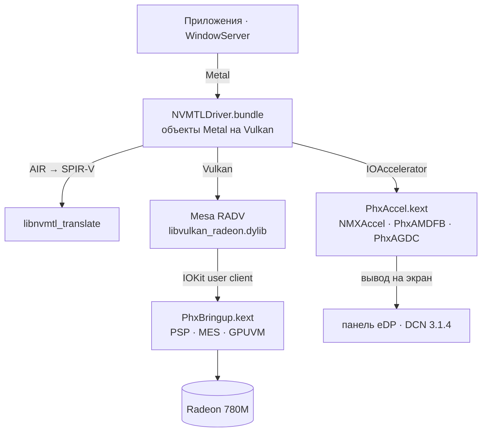

<p align="center">
  <picture>
    <source media="(prefers-color-scheme: dark)" srcset="assets/brand/nullarc-logo-dark.svg">
    
  </picture>
</p>

<p align="center">
  <b>Metal на AMD Radeon 780M в macOS Tahoe.</b><br>
  Запуск GPU, драйвер экрана, на котором композитит WindowServer, и Metal поверх Vulkan (Mesa RADV)<br>
  для APU Phoenix / Hawk Point (RDNA 3, GC 11.0.1, gfx1103).
</p>

<p align="center">
  
  
  
  <a href="https://github.com/luuumi-dev/nullarc/actions/workflows/ci.yml"></a>
  <a href="LICENSE"></a>
</p>

<p align="center"><a href="README.md">English</a> · <b>Русский</b></p>

---

## Состояние

Замерено на эталонной машине — Firebat U6C, Ryzen 7 H 255, Radeon 780M, eDP 2560×1600 120 Гц, macOS Tahoe 26.6.2 —
в октябре 2026:

| | |
|---|---|
| **Рабочий стол** | WindowServer композитит на 780M с частотой панели 120 Гц. Анимации CoreAnimation — 119–120 к/с, перетаскивание окна — 116 к/с. |
| **Liquid Glass** | Док, виджеты, Пункт управления и стекло в приложениях рисует GPU собственными шейдерами композитора Apple (в переводе). |
| **Metal в приложениях** | Устройство Metal получает каждый процесс, включая песочные GPU-процессы WebKit. Проверено около 46 приложений без падений, среди них Safari, Chess и Spotify. |
| **Сон и пробуждение экрана** | Работают. |
| **Первое появление нового эффекта** | Разовая пауза ~1–3 с, пока его шейдер переводится и компилируется. Дальше он берётся из кэша на диске. |
| **Пока нет** | Внешних мониторов (HDMI, USB-C), аппаратного декодирования и кодирования видео, регулировки подсветки. |

Другие машины с Radeon 780M / 760M (Phoenix, Hawk Point) не проверялись.

## Как это устроено



| Компонент | Куда ставится | Исходники | Что делает |
|---|---|---|---|
| `PhxBringup.kext` | OpenCore `EFI/OC/Kexts` | [`src/phxbringup`](src/phxbringup) | Загружает прошивки через PSP, включает GFX (SMU/IMU), запускает планировщик MES и очереди вычислений и графики, даёт каждому процессу своё адресное пространство GPUVM, реализует ABI буферов и отправки команд для RADV. |
| `PhxAccel.kext` | Auxiliary kernel collection | [`src/phxaccel`](src/phxaccel) | IOAccelerator `NMXAccel`, фреймбуфер `PhxAMDFB` (пул видеопамяти, vblank 120 Гц, копирование кадра на экран) и управление дисплеем `PhxAGDC`. |
| `NVMTLDriver.bundle` | `/System/Library/CoreServices/CoreTypes.bundle/Contents/Library/PhxGPU`, ссылка из `/Library/GPUBundles` | [`src/nmplugin`](src/nmplugin) | Плагин драйвера Metal: Metal на Vulkan, IOSurface без копирования, кэши шейдеров. |
| `libvulkan_radeon.dylib` | `PhxGPU/nvmtl` | Mesa + [`mesa-patches-phoenix`](mesa-patches-phoenix) | RADV для gfx1103 с винсисом Darwin. |
| `phxboot` | LaunchDaemon `local.phxboot` | [`tools/phxctl/phxboot.sh`](tools/phxctl/phxboot.sh) | Поднимает GPU при загрузке до того, как WindowServer откроет панель. При сбое откатывается на фреймбуфер прошивки. |

`libnvmtl_translate.dylib` (Metal AIR → SPIR-V, LGPL-3.0, на основе metal2vulkan) идёт готовым в составе плагина
NullMoth; его исходник приложен к каждому релизу. Префикс `NVMTL` тоже от NullMoth: к драйверам NVIDIA всё это отношения не имеет.

## Установка

Скачайте `nullarc-<версия>.zip` со [страницы релизов](https://github.com/luuumi-dev/nullarc/releases) и следуйте
**[docs/INSTALL_RU.md](docs/INSTALL_RU.md)**. Коротко: добавить `PhxBringup.kext` и boot-args в OpenCore,
перезагрузиться, запустить `sudo ./install.sh --windowserver` из папки релиза, перезагрузиться дважды.

> [!WARNING]
> WindowServer загружает драйвер с ad-hoc подписью только при ослабленном AMFI (`amfi=0x80`, `amfi_get_out_of_my_way=0x1`).
> Это выключает проверку библиотек во всей системе, перестаёт работать FairPlay (Apple TV+, Netflix в Safari).
> `uninstall.sh` и последний раздел инструкции возвращают всё как было.

## Сборка

На Маке (Command Line Tools, [MacKernelSDK](https://github.com/acidanthera/MacKernelSDK)):

```sh
sh src/phxbringup/build.sh /path/to/MacKernelSDK      # PhxBringup.kext
sh src/phxaccel/build.sh /path/to/MacKernelSDK        # PhxAccel.kext
```

Плагин собирается из `src/nmplugin/NVMTLDevice.m`, который подключает остальной `src/nmplugin`. RADV: Mesa
`f5cb8ee0` + патчи Darwin от Cobalt64 + [`mesa-patches-phoenix`](mesa-patches-phoenix/README.txt).

Модульные тесты (разбор прошивок, IP discovery) идут на Linux и macOS и в CI:

```sh
make fixtures   # прошивки Phoenix из linux-firmware
make test
```

## Заметные исправления

- **IOSurface без копирования** — текстуры как линейные изображения прямо на страницах поверхности; CPU WindowServer 77 % → 36 %.
- **Кэш удержания поверхностей** — CoreAnimation каждый кадр заново оборачивает одни и те же IOSurface; удержание их импорта подняло перетаскивание окна с 64–69 до 116 к/с.
- **Пул видеопамяти** — непрерывная память под каждое выделение фрагментировалась за часы, и пробуждение экрана зависало; теперь один пул на 512 МБ.
- **Списки mutable-дескрипторов в RADV** — индексировались по отсортированному порядку биндингов вместо исходного; ломало размытия CoreImage и слоистые иконки Tahoe.
- **Развёртка вложенных циклов (Mesa 0006)** — новый вариант шейдера композитора компилировался в RADV ~2 с, по уровню цикла за круг оптимизаций; теперь ~1 с с тем же кодом.

## Название

**null + arc**: знак пустого множества — драйвера, которого не было, — с кольцом, разомкнутым в дугу.
Подробнее в [гайде по стилю](assets/brand/README.md).

## Лицензии и благодарности

Действует несколько лицензий, см. [LICENSE](LICENSE), [THIRD_PARTY_NOTICES.md](THIRD_PARTY_NOTICES.md) и [LICENSES/](LICENSES).

- Код, написанный для nullarc (`src/phxbringup`, `tools/phxctl`, …): MIT или, на ваш выбор, GPL-2.0-only.
- `src/phxaccel`, `src/nmplugin`, `tools/nvmtl-patches`: производные от драйвера NullMoth для macOS, **PolyForm Noncommercial 1.0.0** — без коммерческого использования.
- `mesa-patches-phoenix`: MIT, как Mesa. В пакетах релиза есть также LGPL-3.0 (транслятор шейдеров), LLVM и прошивки AMD; см. уведомления.

Основано на работе команды Linux `amdgpu`, Mesa, NullMoth, [Cobalt64](https://cobalt64.com),
[Acidanthera](https://github.com/acidanthera) и сообщества AMD-OSX.
