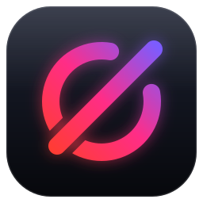

# nullarc brand

<p>
  
</p>

**The mark.** The empty-set sign ∅ (a driver that did not exist: *null*) whose ring is broken where the stroke leaves it
(*arc*). The stroke runs Radeon red → Metal violet: AMD hardware on one end, Apple's API on the other. The ring is cut
around the stroke where they cross, and both sit on a dark rounded tile with a glass sheen, like a macOS app icon.

**The wordmark.** Lowercase, monoline, round caps, drawn from strokes (no font needed): *null* in ink, *arc* in the
brand gradient. Always one word, always lowercase: **nullarc**.

## Files

| File | Use |
|---|---|
| `nullarc-mark.svg` | icon, avatar, favicon (renders down to 32 px) |
| `nullarc-logo-dark.svg` | mark + wordmark on dark backgrounds |
| `nullarc-logo-light.svg` | mark + wordmark on light backgrounds |
| `nullarc-social.png` | 1280×640 repository social preview |

In a README, let the reader's theme pick the lockup:

```html
<picture>
  <source media="(prefers-color-scheme: dark)" srcset="assets/brand/nullarc-logo-dark.svg">
  
</picture>
```

## Colours

| Name | Hex | Role |
|---|---|---|
| Radeon Ember | `#FF3D2E` | gradient start |
| Flux Magenta | `#FF2D87` | gradient middle |
| Metal Violet | `#7C5CFF` | gradient end |
| Ink | `#0B0D12` | wordmark on light, tile bottom `#07080C` |
| Graphite | `#1C2131` | tile top |
| Mist | `#F2F4F8` | wordmark on dark |

The gradient runs along the stroke direction (bottom-left → top-right in the mark, left → right in *arc*).

## Don'ts

- Don't recolour the gradient, set the wordmark in a font or uppercase it.
- Don't put the mark without its tile on a busy background; keep a clear space of a quarter of the tile around it.
- Don't stretch, rotate or add effects beyond the built-in glow.

`tools/brand/lockup.py` regenerates both lockups from the mark.
